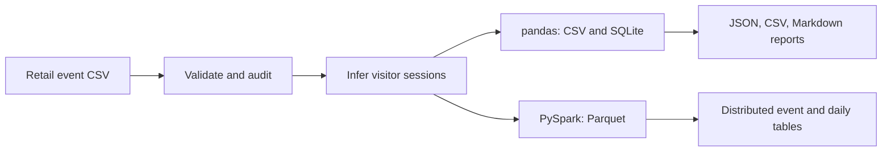

# OmniHealth AI

### Marketing Intelligence and Predictive Analytics Platform

A reproducible retail clickstream analytics project that turns event logs into validated data, visitor sessions, and explainable business metrics. It provides a tested foundation for future conversion-propensity modeling and healthcare-inspired marketing simulations.

**Release 0.5.0 · Python · pandas · SQL/SQLite · PySpark · Docker · GitHub Actions**

[Automated checks](https://github.com/RNanfuka/clickstream-analytics/actions/workflows/ci.yml) · [Measured results](docs/results/README.md) · [Milestones](docs/milestones.md) · [Learning guide](docs/learning_guide.md)

## What works today

- **Data engineering:** CSV contracts, field validation, rejected-row audits, configurable inactivity sessions, and input fingerprints.
- **Behavioral analytics:** Daily engagement, session conversion, visitor summaries, engagement groups, and an ordered view → cart → purchase report.
- **Reproducibility:** Run status, output locks, software-version records, JSON/CSV/Markdown reports, and deterministic synthetic benchmarks.
- **Delivery:** A Python package, optional Spark/Parquet processing, a non-root container, and automated checks on GitHub.

**Data scope:** The included example and published benchmark results are synthetic retail data. The pipeline also accepts separately downloaded RetailRocket events. No full RetailRocket analysis, healthcare data analysis, trained ML model, live API, or deployed dashboard is claimed. Scikit-learn, FastAPI, and Streamlit belong to the [future roadmap](docs/roadmap.md).

## Business question

“How does website activity translate into sessions containing purchases, and can we trust the numbers?”

An event log records actions, not ready-made answers. This project checks those records, groups actions into visits, and defines consistent metrics before introducing predictive modeling. The long-term application is marketing intelligence; the current evidence concerns retail event processing.

## Verified results

The [verification record](docs/results/verification.json) was generated on **November 11, 2026**. The full local suite passed **47 tests**, including four Spark tests, with no failures or skips. GitHub CI also verifies the core workflow on Python 3.11 and 3.12, the Spark tests, an installed wheel, and the Docker demo.

### Included synthetic fixture

| Measure | Result |
|---|---:|
| Input / valid events | 28 / 28 |
| Rejected events | 0 |
| Distinct visitors | 5 |
| Sessions | 8 |
| Sessions containing a transaction | 4 |
| Session conversion rate | 50% |
| Sessions with an ordered view → cart → purchase | 3 |
| Ordered view-to-purchase rate | 37.5% |

The two rates answer different questions: any transaction in a session versus a transaction after a view and a later cart. Both are **fixture checks**, not findings about real customer or patient behavior.

### Measured pandas runs

| Synthetic events | Sessions | Repeats | Median elapsed time |
|---:|---:|---:|---:|
| 10,000 | 2,500 | 3 | 1.195 seconds |
| 100,000 | 25,000 | 3 | 12.551 seconds |

Measured locally on macOS ARM64, 12 logical CPUs, Python 3.11.18, pandas 2.3.3, and NumPy 2.4.6. Timings include input reading, validation, hashing, sessionization, CSV/SQLite output, and reports. Generation is excluded. There was no dedicated warm-up; filesystem caching was uncontrolled. These are not production throughput guarantees or distributed-cluster benchmarks. [Method, raw timings, and reproduction commands](docs/results/README.md).

## Run it locally

The primary setup uses Conda on macOS or Linux:

```bash
# Run once from the repository root.
conda env create --prefix ./.conda --file environment.yml

# Run whenever you open a new working terminal.
conda activate ./.conda
```

If `.conda` already exists, just activate it. The environment includes Python 3.11, Java 17, PySpark, and development tools. In VS Code, select `.conda/bin/python` using **Python: Select Interpreter**.

```bash
make validate   # Inspect the fixture without creating analytics.
make demo       # Process the fixture into CSV facts and SQLite.
make report     # Display a shareable Markdown summary.
make test       # Run core tests; Spark tests are intentionally skipped.
make test-all   # Run all tests, including Spark.
make lint       # Check code style.
```

The Makefile selects the project Python and, when available, its Java installation. To update dependencies, run `conda env update --prefix ./.conda --file environment.yml`.

### Inspect and export results

```bash
python -m omnihealth.cli report --output-dir artifacts/demo --view funnel
python -m omnihealth.cli report --output-dir artifacts/demo --view visitors --format csv
python -m omnihealth.cli report --output-dir artifacts/demo --view engagement --format markdown
```

Available views: `overall`, `daily_events`, `daily_sessions`, `stages`, `funnel`, `visitors`, and `engagement`. [Definitions and examples](docs/analytics.md).

```text
artifacts/demo/
├── processed/
│   ├── events.csv
│   └── sessions.csv
├── analytics/
│   └── omnihealth.db
└── reports/
    ├── run_status.json
    ├── data_quality.json
    ├── pipeline_summary.json
    └── rejected_events.csv  # Present only when rows are rejected.
```

A rerun replaces the managed outputs in that destination. Failed runs retain available quality audits and remove stale analytical results. Use separate output directories to retain earlier runs. Reports require completed status. [Run lifecycle and recovery](docs/reproducibility.md).

## How the pipeline works



1. Preserve identifiers as text and validate millisecond timestamps, event types, and transaction IDs.
2. Retain repeated actions and report exact duplicates. Stop when the unrounded rejected-row fraction exceeds the configured threshold; the default is 1%.
3. For each visitor, start a new session only when inactivity is **strictly greater than 30 minutes**. A session can cross midnight.
4. Count a session as converted when it contains at least one transaction. Count distinct order IDs within each session separately from transaction rows.
5. Record the input SHA-256, processing settings, software versions, and run completion state.

Stage presence does not establish sequence. The ordered funnel requires strictly increasing timestamps and is session-level, not item-level. The data has no campaign identifiers, media costs, or channel attribution. [Data dictionary](docs/data_dictionary.md) · [Architecture decisions](docs/architecture.md).

## Use real RetailRocket data

Download the public [RetailRocket dataset](https://www.kaggle.com/datasets/retailrocket/ecommerce-dataset), review the publisher's terms, and place `events.csv` in `data/raw/`.

```bash
python -m omnihealth.cli validate --input data/raw/events.csv --source-type retailrocket
python -m omnihealth.cli run --input data/raw/events.csv --output-dir artifacts/retailrocket --source-type retailrocket
```

The real dataset is not included. Keep it and generated outputs out of Git. `--limit-rows` processes a prefix for inspection; that prefix is not a representative sample. Real-data observations should be reported separately from the published synthetic checks.

### Spark and containers

```bash
make demo-spark
make test-spark

# With Docker running:
docker build -t omnihealth:0.5.0 .
docker run --rm omnihealth:0.5.0
```

Spark writes Parquet and runs the transformations in the Spark engine. The SQLite report command applies to pandas outputs. Local Make commands use two Spark workers by default. Spark correctness has been checked on small synthetic inputs; full-dataset and cluster performance remain unmeasured.

The container runs the pandas fixture as a non-root user and prints its summary. For persistent results on macOS/Linux:

```bash
mkdir -p artifacts/container
docker run --rm --user "$(id -u):$(id -g)" \
  -v "$(pwd)/artifacts/container:/app/artifacts" omnihealth:0.5.0
```

## Five completed milestones

| Tag | Capability delivered |
|---|---|
| [v0.1.0](https://github.com/RNanfuka/clickstream-analytics/releases/tag/v0.1.0) | Initial pandas/Spark analytics foundation |
| [v0.2.0](https://github.com/RNanfuka/clickstream-analytics/releases/tag/v0.2.0) | Trustworthy input handling and validation CLI |
| [v0.3.0](https://github.com/RNanfuka/clickstream-analytics/releases/tag/v0.3.0) | Reproducible runs, failure handling, and report exports |
| [v0.4.0](https://github.com/RNanfuka/clickstream-analytics/releases/tag/v0.4.0) | Behavioral analytics, ordered funnel, and synthetic generator |
| [v0.5.0](https://github.com/RNanfuka/clickstream-analytics/releases/tag/v0.5.0) | Package/container verification, expanded CI, and measured results |

[Milestone acceptance criteria](docs/milestones.md) · [Changelog](CHANGELOG.md)

## Next: predictive modeling

The next phase requires real-data exploration, a clearly defined prediction time and outcome window, features available before that cutoff, time-based evaluation, and a baseline model. Model accuracy, campaign uplift, and healthcare outcomes have not been measured. The [roadmap](docs/roadmap.md) separates these future tasks from completed engineering work.

## Project map

- `src/omnihealth/`: ingestion, validation, sessions, pipeline, provenance, reporting, and generation.
- `src/omnihealth/sql/marts.sql`: reviewable metric definitions.
- `tests/`: contract, boundary, failure, reporting, CLI, and Spark checks.
- `scripts/`: demo runner, installed-package check, and benchmark reproduction.
- `docs/`: definitions, decisions, learning notes, and measured evidence.
- `.github/workflows/`: automatic CI and a manually runnable Spark workflow.

## Attribution

Project code: [MIT License](LICENSE). The small included fixture and benchmark generator are synthetic. RetailRocket data is distributed separately by its publisher on Kaggle and remains subject to that dataset's terms. The name OmniHealth describes the intended future application domain.
