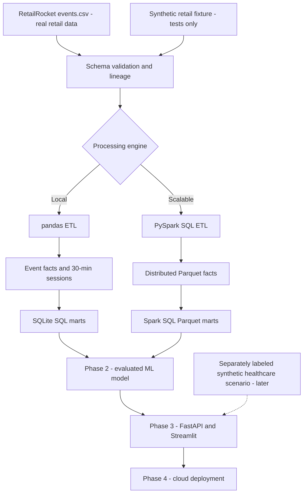

# OmniHealth AI

### Marketing Intelligence and Predictive Analytics Platform

An end-to-end data science and analytics platform designed to transform digital engagement data into actionable marketing intelligence through scalable data engineering, machine learning, and interactive analytics.


### Overview

OmniHealth AI explores how organizations can leverage digital interaction data to understand customer journeys, identify conversion opportunities, and build reliable predictive analytics solutions.

The platform is designed around three core capabilities:

- **Data Engineering:** Build reproducible pipelines for event processing, data quality validation, sessionization, and analytical reporting.
- **Marketing Analytics:** Analyze engagement patterns, conversion funnels, user journeys, and behavioral trends to support data-driven decision-making.
- **Predictive Intelligence:** Develop and evaluate machine learning models for conversion propensity, with a foundation for future deployment and monitoring.

### Business Problem

Marketing teams generate large volumes of digital interaction data, yet converting these events into reliable, decision-ready insights remains challenging.

OmniHealth AI addresses this challenge by developing an extensible analytics architecture that connects data processing, behavioral analysis, and predictive modeling.

The long-term application focuses on omnichannel healthcare and pharmaceutical marketing intelligence, including campaign engagement, audience segmentation, and conversion optimization.

### Current Implementation

**Phase 1 — Data Engineering and Analytics Foundation**

The implemented foundation includes Python-based ETL processing, data quality checks, behavioral sessionization, SQL analytics, an optional PySpark processing path, automated testing, and containerization.

Subsequent phases extend the platform to predictive modeling, application interfaces, and healthcare marketing simulations.

> **Evidence and domain disclaimer:** Phase 1 uses the **real, anonymized RetailRocket retail e-commerce dataset**, NOT healthcare records. A small, explicitly labeled **synthetic retail test fixture** is included solely to verify the code. The data has no actual marketing channels or healthcare context. The term *OmniHealth* describes the planned application domain, not the source data. Future synthetic healthcare scenarios must remain separately labeled.

## Implemented: Phase 1

| Capability | Status | Output |
|---|---|---|
| Event ingestion | Implemented (pandas) | Typed clickstream facts |
| Schema and field validation | Implemented | Quality report and rejected-row audit |
| 30-minute visitor sessionization | Implemented | Session facts with defensible KPI definitions |
| SQL analytics | Implemented (SQLite) | Daily engagement, daily session conversion, overall metrics |
| Distributed ETL | Implemented (optional PySpark) | Parquet facts and Spark SQL daily marts |
| Automated test suite | Implemented | `pytest` tests and GitHub Actions pipeline |
| Containerized ETL | Implemented | `Dockerfile` for pandas pipeline |
| ML model | **Not yet implemented** | Planned Phase 2 |
| FastAPI and Streamlit | **Not yet implemented** | Planned Phase 3 |
| Cloud deployment | **Not yet implemented** | Planned Phase 4 |

The Spark route is provided as **optional code**; this release's verified execution record covers the pandas pipeline. Run the opt-in Spark test in your Java-enabled environment before treating it as verified.

## Development environment (Conda, including Spark)

From the project root, create and activate an isolated environment:

```bash
conda env create --prefix ./.conda --file environment.yml
conda activate ./.conda
```

If `.conda` already exists, just activate it. This environment includes Python 3.11,
Java 17, PySpark, and the project's development dependencies.

In VS Code, run **Python: Select Interpreter** and select `.conda/bin/python`.
Open a new terminal and activate the environment before running commands:

```bash
make demo
make test
make test-spark
make lint
```

To update the environment after dependency changes, run
`conda env update --prefix ./.conda --file environment.yml` from the project root.
The environment and generated artifacts are excluded from Git.

## Quickstart (Python 3.11 recommended)

```bash
# 1. Create an isolated environment, from repository root.
python3.11 -m venv .venv
source .venv/bin/activate   # Windows PowerShell: .venv\Scripts\Activate.ps1

# 2. Install in editable mode.
python -m pip install -e '.[dev]'

# 3. Run the small, explicitly SYNTHETIC retail fixture.
python -m omnihealth.cli run \
  --input data/samples/synthetic_retail_events.csv \
  --output-dir artifacts/demo \
  --source-type synthetic_fixture

# 4. Confirm reproducibility.
python -m pytest -q
```

Alternatively, use `make demo`, `make test`, and `make lint` after installation.

### The output layout

```text
artifacts/demo/
├── processed/
│   ├── events.csv                    # Event-level facts with session_id
│   └── sessions.csv                  # Session-level facts
├── analytics/
│   └── omnihealth.db                # SQLite tables + SQL views
└── reports/
    ├── data_quality.json            # Validation, rejection and duplicate counts
    ├── pipeline_summary.json        # Source provenance, definitions, run summary
    └── rejected_events.csv          # Only present when invalid rows exist
```

Run SQL analytics in Python without extra database tools:

```bash
python - <<'PY'
import sqlite3
with sqlite3.connect('artifacts/demo/analytics/omnihealth.db') as db:
    print(db.execute('SELECT * FROM v_overall_kpis').fetchall())
    print(db.execute('SELECT * FROM v_daily_session_kpis').fetchall())
PY
```

These are **fixture results only**, not findings about RetailRocket users or patients.

## Use the real public dataset

1. Open the [RetailRocket dataset on Kaggle](https://www.kaggle.com/datasets/retailrocket/ecommerce-dataset).
2. Review its attribution and noncommercial/share-alike licensing terms (**CC BY-NC-SA 4.0**, per Kaggle).
3. Download the data and place **`events.csv`** at `data/raw/events.csv` (the `raw/` directory is gitignored).
4. Run:

```bash
python -m omnihealth.cli run \
  --input data/raw/events.csv \
  --output-dir artifacts/retailrocket \
  --source-type retailrocket
```

The core Phase 1 ETL only requires `events.csv`. The original dataset also provides item properties and a category tree, which are intentionally excluded until a time-aware enrichment pipeline is developed. Do **not** commit the downloaded dataset, generated data, secrets, or large artifacts to GitHub.

### Scale-out execution (optional PySpark)

Use Python 3.11 and Java 17+ for Spark 4.x. Install and launch:

```bash
python -m pip install -e '.[spark,dev]'
java -version

python -m omnihealth.cli spark-run \
  --input data/raw/events.csv \
  --output-dir artifacts/retailrocket_spark \
  --source-type retailrocket

# Spark smoke/integration test (requires a working Spark/Java installation):
OMNIHEALTH_TEST_SPARK=1 python -m pytest -q tests/test_spark.py
```

The Spark implementation performs transformations in the Spark engine and writes **Parquet directories** under `processed/` and `analytics/`; it does not materialize all events into pandas or a SQLite database. The pandas route writes CSV + SQLite. Their downstream storage formats are deliberately distinct.

Documentation: [Spark installation](https://spark.apache.org/docs/latest/api/python/getting_started/install.html).

## Architecture



Phase 1 preserves clear **raw / validated / session / mart** distinctions and records provenance at every run. See [design decisions](docs/architecture.md).

## Event contract and KPIs

| Field in `events.csv` | Meaning |
|---|---|
| `timestamp` | Unix epoch in **milliseconds**, normalized to UTC |
| `visitorid` | Anonymized visitor identifier, treated as a string |
| `event` | Exactly `view`, `addtocart`, or `transaction` |
| `itemid` | Anonymized item identifier, treated as a string |
| `transactionid` | Nonempty on transactions; otherwise empty/NULL |

**Session definition:** For each visitor, sort events by UTC time. A new session starts when the interval from the preceding event is **strictly more than 30 minutes** (configurable).

**Session conversion rate:**

```text
number of sessions containing >=1 transaction event
---------------------------------------------------
                  total sessions
```

The `order_count` counts **distinct transaction IDs within each session**, preventing multiple line items in the same order from inflating the count. The sum of session order counts is not necessarily globally distinct if an order ID spans sessions. Event-level `transaction_events` counts transaction rows, which is a different measure.

**Not a true funnel:** `v_session_stage_presence` reports whether sessions include each type of action, but does not imply a view → cart → transaction sequence. The source does not identify channels, impressions, costs, campaign IDs, or exposure; ROAS and multichannel attribution cannot honestly be computed.

Full definitions: [data dictionary](docs/data_dictionary.md).

## Data quality safeguards

- Reject absent/incorrect fields, unparseable or implausible millisecond timestamps, missing visitor/item IDs, unsupported events, and inconsistent transaction IDs.
- Write rejected rows with all applicable reasons; a quality gate stops processing if more than 1% are rejected by default (`--max-rejected-fraction`).
- **Retain exact duplicates and report their count**. Raw logs may legitimately contain repeated actions; silent deduplication would change behavior.
- Preserve identifiers as strings; normalize event timestamps to UTC; keep original source data out of Git.
- Label every output's source as `retailrocket` or `synthetic_fixture`.

## Project layout

```text
omnihealth-ai/
├── .github/workflows/ci.yml
├── .github/workflows/spark-smoke.yml
├── data/
│   ├── README.md
│   └── samples/synthetic_retail_events.csv
├── docs/
│   ├── architecture.md
│   ├── data_dictionary.md
│   └── roadmap.md
├── scripts/run_demo.sh
├── src/omnihealth/
│   ├── __init__.py
│   ├── cli.py
│   ├── contracts.py
│   ├── quality.py
│   ├── sessions.py
│   ├── pipeline.py
│   ├── spark_pipeline.py
│   └── sql/marts.sql
├── tests/
│   ├── test_quality.py
│   ├── test_sessions.py
│   ├── test_pipeline.py
│   └── test_spark.py
├── Dockerfile
├── Makefile
├── pyproject.toml
├── .gitignore
└── README.md
```

## Docker: run the pandas demo

```bash
docker build -t omnihealth-ai:phase1 .
docker run --rm -v "$(pwd)/artifacts:/app/artifacts" omnihealth-ai:phase1
```

The Docker image intentionally ships only the pandas ETL and synthetic retail fixture. This is **not** a patient-data service, live API, deployed UI, or healthcare decision support product.

## Testing and engineering conventions

```bash
python -m pytest -q             # validation + session + end-to-end SQL tests
python -m ruff check .          # static lint
python -m compileall -q src    # syntax check
```

GitHub Actions installs the package, lints it, runs tests, executes the demo CLI, and checks generated files. The optional Spark integration test is disabled by default; run it explicitly when Spark and Java are installed, or trigger the separate **Optional PySpark smoke test** workflow manually from GitHub Actions after pushing the repository.

## Current limitations and milestones

Phase 1 does **not** establish model accuracy, causal uplift, pharmaceutical conversion, digital channel attribution, or production-scale SLOs. These require additional data and evaluation. The [roadmap](docs/roadmap.md) proposes a leakage-resistant, temporally evaluated retail conversion propensity baseline, with a separate healthcare-inspired synthetic demonstration only after factual retail modeling is established.

## GitHub publishing

```bash
git init
git add .
git commit -m "feat: build validated RetailRocket analytics pipeline"
git branch -M main
# Create an empty GitHub repo named omnihealth-ai, then set its URL:
git remote add origin https://github.com/YOUR_USERNAME/omnihealth-ai.git
git push -u origin main
```

**Do not** copy the real RetailRocket dataset or generated artifacts into the repo. Confirm `git status` before every push.

## Licensing and attribution

- **Code** in this repository: [MIT License](LICENSE).
- **RetailRocket data:** Distributed separately by its publisher on Kaggle under **CC BY-NC-SA 4.0**; not included in this repository. Dataset citation: RetailRocket recommender system dataset, published by Roman Zykov on Kaggle, https://www.kaggle.com/datasets/retailrocket/ecommerce-dataset.
- **Synthetic fixture:** Original tiny synthetic retail event table for software testing; not real observations.

---

*Project theme: From event data to trustworthy decisions. Accuracy, auditability, and business relevance take priority over flashy claims.*
